<p align="center">
  
</p>

<p align="center">
  <a href="https://linkedin.com/in/annie-wu06"></a>
  <a href="mailto:annie.wu2024@gmail.com"></a> 
</p>

### 🌲 field notes

```text
> name ......... Annie Wu
> base camp .... Vancouver, BC
> studying ..... BSc Computer Science (Co-op) @ UBC, 3rd year
> currently .... CTMS Co-op @ Vancouver Coastal Health Research Institute
> building ..... HATRIC, an LLM/VLM robot that hosts soccer trivia
> interests .... AI agents · embedded systems · data & predictive modeling
> off-trail .... hiking BC, soccer, finding new side quests
```

I like building things that do something in the real world, like a trivia-hosting robot or a box of RFID sensors that keeps track of inventory. Right now I'm on co-op at VCH Research Institute, setting up data tools for clinical research studies. When I'm not working, I'm probably hanging out outside with friends and family in beautiful British Columbia.

### 🎒 supply pack

<p align="center">
  
</p>

<p align="center"></p>

### 🗺️ trail map

**HATRIC** (in progress)<br>
A little robot that hosts soccer trivia for 2–4 people. It uses an LLM to decide who to talk to and a vision model on a webcam to see who's actually paying attention.<br>
<sub>python · ollama · fastapi · esp32</sub>

**[fifa2026](https://github.com/awu0521/fifa2026)**<br>
My attempt at predicting the 2026 World Cup. It simulates the tournament 200,000 times using Elo ratings, and it called 83.8% of past matches correctly when I tested it.<br>
<sub>python · node · express</sub>

**[inventory-tracker](https://github.com/awu0521/inventory-tracker)**<br>
Two RFID sensors and an ESP32 that log items going in and out, plus a server and web page to see it all.<br>
<sub>c++ · esp32 · typescript</sub>

**[TrackTheTrek](https://github.com/awu0521/TrackTheTrek)**<br>
A desktop app for keeping track of BC hikes I've done and ones I want to do, with pace and distance stats.<br>
<sub>java</sub>

**[how-cooked-are-you](https://howcookedareyou.vercel.app)**<br>
Put in your assignments and due dates and it tells you how cooked you are, then makes a study schedule you can add to your calendar.<br>
<sub>next.js · typescript</sub>

**[save-our-foods](https://github.com/hackscholar/save-our-foods)**<br>
A marketplace for selling extra food before it expires. Snap a photo and Gemini fills in the name, expiry date and a price.<br>
<sub>next.js · supabase · gemini</sub>

<p align="center"></p>

### 📟 trail log

<p align="center">
  
  
</p>

### 🔥 around the campfire

- I plan socials for the UBC Computer Science Student Society
- I've taught middle schoolers to build their first websites with GIRLsmarts4tech
- Ask me who's winning the World Cup (my model says Argentina, barely)
- Send me your favourite BC trail and I'll add it to my list
- Open to co-op, internships and fun collabs

<p align="center">
  
</p>
